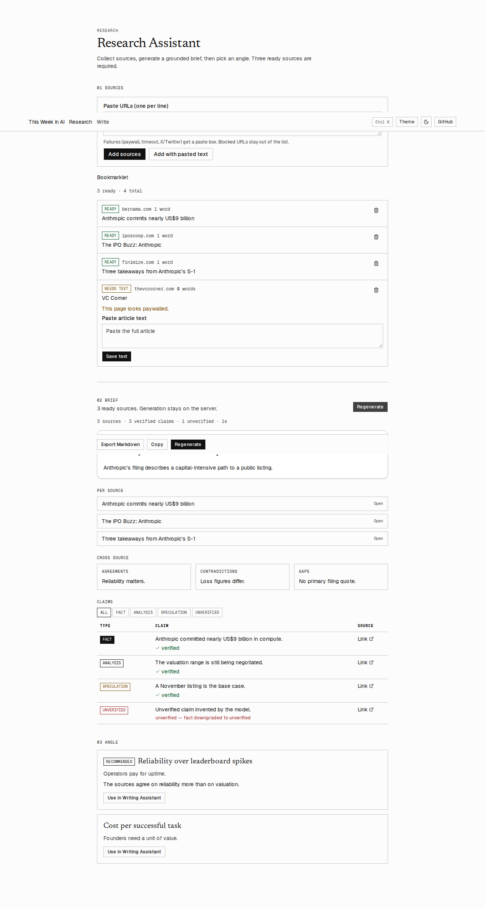
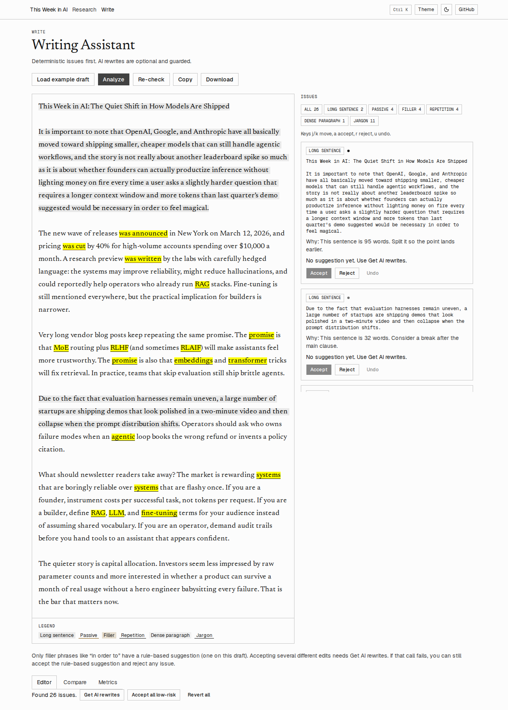

# Newsletter Assistant

A research and writing workspace for editing *This Week in AI*. Paste public article URLs, generate a grounded brief, pick an angle, then revise a draft with deterministic issue flags and optional guarded rewrites.

Live app: https://newsletter-assistant-navy.vercel.app

Source: https://github.com/tejasmmali/Newsletter-Assistant

## Setup

Node 22. Install dependencies and run the app locally:

```bash
npm install
npm run dev
```

Copy the variable names below into `.env.local`. Do not commit that file. Values stay in the host environment (Vercel for the deployed app).

| Name | Where it is used |
| --- | --- |
| `GEMINI_API_KEY` | Server. Gemini calls for briefs and rewrites. |
| `GEMINI_MODEL` | Server. Primary model. |
| `GEMINI_FALLBACK_MODEL` | Server. Used after timeout, 429, or 503. |
| `NEXT_PUBLIC_SUPABASE_URL` | Server. Supabase project URL. |
| `NEXT_PUBLIC_SUPABASE_ANON_KEY` | Public client key. Row Level Security still blocks anonymous reads and writes. |
| `SUPABASE_SERVICE_ROLE_KEY` | Server only. The API routes use this key. |
| `INGEST_TOKEN` | Server only. `POST /api/ingest` requires `Authorization: Bearer`. |

## Scripts

| Script | What it runs |
| --- | --- |
| `npm run dev` | Next.js dev server. |
| `npm run build` / `npm start` | Production build and server. |
| `npm run typecheck` | `tsc --noEmit`. |
| `npm run lint` | ESLint. |
| `npm run test` | Vitest unit tests. |
| `npm run test:e2e` | Playwright against a local dev server. |
| `npm run check` | Typecheck, lint, unit tests, and Playwright, in that order. |

## Architecture

```text
Browser
  /research                          /write
  SourcesPanel                       WriteWorkspace
       |                                   |
       | POST /api/sources                 | local analyzeDraft (no model)
       | PATCH /api/sources/:id            | POST /api/rewrite (optional)
       | DELETE /api/sources/:id           |
       | POST /api/brief                   |
       v                                   v
Next.js route handlers (Node)
  url-safety  -> extract -> sources table (service role)
  brief.ts    -> llm.ts (Gemini, JSON schema, 45s deadline)
  rewrite.ts  -> llm.ts -> rewrite-guard.ts
       |
       v
Supabase `sources` (RLS on, no public policies)
```

`POST /api/ingest` is the bookmarklet path. It checks the bearer token before it checks the URL.

## What is model output, and what is not

| Step | Who decides |
| --- | --- |
| URL allow-list and SSRF block | Deterministic (`assertSafePublicUrl`). |
| Article extract and paywall flag | Deterministic heuristics in `lib/extract.ts`. |
| Issue list (long sentence, passive voice, filler, repetition, dense paragraph, jargon) | Deterministic (`lib/analyzer.ts`). Offsets satisfy `text.slice(start, end) === original`. |
| Rule suggestion | Only the filler pattern `in order to`, suggested as `to`. |
| Brief prose, claims, and angles | Gemini, constrained by a JSON schema. Claims are capped at 12. Angles are 2 or 3. |
| Claim `verified` flag | Deterministic grounding. A fact whose quote is missing is stored as unverified. |
| Rewrite text | Gemini, then `validateRewrite`. A failed guard keeps the original sentence. |
| Accept, reject, undo, revert | The editor. Nothing is applied until the editor accepts it. |

## Product note

The primary user is the person drafting *This Week in AI*: they have a few articles, a deadline, and a low tolerance for invented numbers.

The core problem is turning several writeups of the same story into a brief the editor can check, then into a draft that can be tightened without silently changing facts.

Workflow: add sources, paste text when a page is paywalled or truncated, generate a brief, choose an angle, load or write a draft, accept or reject issues, compare, and copy the result.

Included in this build: source status (Ready, Needs text, Failed), a grounded brief, angle handoff into the writing page, issue highlights, compare, and metrics. Deliberately limited: the model does not think (budget 0) so briefs stay inside the platform timeout, claims stop at 12, and the only built-in rewrite suggestion is filler. AI rewrites are optional and never auto-applied.

The success criteria this build is held to: a brief for three ready sources returns in under 45 seconds, every claim is either tied to a quote in the source or marked unverified, and a rewrite that drops a number, name, hedge, or jargon term is rejected.

## Engineering note

Failure handling:

- A blocked URL returns HTTP 400 `{ error: "invalid_url", message }` and the UI shows `message`.
- Paywalled or truncated pages are flagged from phrases such as “subscribe to continue”. Articles of 8,000 characters or more are not flagged, so a long live blog is left Ready.
- Invalid model JSON fails schema validation and returns a retryable 502. The issues are logged on the server and are not sent to the browser.
- HTTP 429 from Gemini is returned as `code: "rate_limited"`. The UI tells the editor to wait a minute. Callers should wait and retry, not change the prompt.
- The brief route aborts at 45 seconds and returns HTTP 504 `{ error: "timeout", retryable: true }`. `maxDuration` is 60.
- Timeout, 429, and 503 try `GEMINI_FALLBACK_MODEL` when it is set.

Grounding proves a supporting quote occurs in the extracted text. It strips straight quotes, looks for an exact normalized match, then a fuzzy window at 0.9 or better. It does not prove the claim is true, that the source is right, or that two sources agree. Contradictions are listed and left unresolved.

Security: Row Level Security is enabled on `sources` and there are no public policies. An anonymous request can see no rows and cannot insert. The service-role key, the Gemini key, and `INGEST_TOKEN` are read only on the server. `assertSafePublicUrl` rejects non-http(s) URLs and private or local hosts before any fetch.

Trade-offs: thinking is disabled so a three-source brief returns well under the 45 second cap (10–12 seconds on the preview listed in `REPORT.md`). The claim cap is 12, so a long filing is summarized rather than fully extracted. Rule suggestions are limited to filler so the app does not invent a “fix” for a long sentence.

With another day I would verify the bookmarklet against the real ingest token, show the working draft in the editor after each accept (today the highlights stay on the original text and Compare shows the result, which is what keeps offsets stable), and add a per-source word control so a brief never silently includes every Ready row in the table.

## Editorial note

Clear newsletter writing names the source, keeps the number next to the claim, and does not upgrade a hedge into a fact. A useful assistant flags long sentences, filler, and jargon, and it shows the sentence it wants to change.

Evaluate it by checking three things: the highlighted span is the same string as the quoted original, Accept does nothing when there is no suggestion, and Compare after Revert all matches the analyzed draft.

The tool must not auto-apply an edit the guard rejects. These cases are asserted in `__tests__/rewrite-guard-adversarial.test.ts`:

- “Revenue rose 37% after launch.” must not become “Revenue rose after launch.” (`missing_number`)
- “Customers pay $10,000 a month for seats.” must not drop the amount.
- “The preview landed on March 12, 2026.” must not become “recently.”
- “Claude remains popular with operators.” must not become “The chatbot…” (`missing_name`)
- “The lab reportedly delayed the release.” must not drop “reportedly” (`missing_hedge`)

A safe shorten is allowed: “OpenAI may cut prices by 40% for Claude users.” can become “OpenAI may reduce prices by 40% for Claude users.” The hedge, the percent, and the name stay.

On the preview, `POST /api/rewrite` for “OpenAI reportedly spent $40 million on RLHF in Q3 2026, which may improve reliability by 12%.” returned the original sentence with `guard_rejected: true`. The amount, the hedge, the year, the percent, RLHF, and OpenAI all remained.

## Assumptions

- Editors can paste article text when a site is paywalled. The app does not log in anywhere.
- Three Ready sources are required before a brief. Needs-text rows are excluded until text is saved.
- “Verified” means the quote was found in the extract, not that the journalist was right.
- The sample newsletter in `docs/sample/` is a starting point. The author still edits it.

## Known limitations

- The bookmarklet asks for the ingest token at click time and does not store it. A live call with the real token was not run from this environment.
- Brief generation includes every Ready source, not a selected subset, unless the client sends `source_ids`.
- Flesch reading ease is labeled as a rough signal in the metrics panel. Do not treat it as a grade.
- Highlight offsets are computed on the analyzed original. Accepted wording shows up in Compare. Editing the textarea after analysis asks for confirmation and clears those accepts.

## Sample and screenshots

The live brief, the draft, and the newsletter draft are in [`docs/sample/`](docs/sample/).

Light desktop:





The same pages in dark mode and at 390px wide are `docs/screenshots/research-dark-desktop.png`, `docs/screenshots/write-dark-desktop.png`, `docs/screenshots/research-light-390.png`, `docs/screenshots/research-dark-390.png`, `docs/screenshots/write-light-390.png`, and `docs/screenshots/write-dark-390.png`.

## UI libraries

Geist Sans and Geist Mono for the chrome. Newsreader for the draft, brief headings, and Compare. shadcn-style primitives (Button, Card, Badge, Tabs, Tooltip, AlertDialog, Sheet, Skeleton, Separator, ScrollArea, Textarea, Input, Table, Collapsible, DropdownMenu, Command) on Tailwind. Also `lucide-react`, `sonner`, `next-themes`, `framer-motion`, `cmdk`, `react-textarea-autosize`, `diff`, `clsx`, `tailwind-merge`, and `class-variance-authority`.

## AI tools

The Cursor agent generated most of the application code. Gemini is called at runtime for briefs and for optional rewrites. Guardrails, grounding, and the issue list are ordinary TypeScript.

### What I personally implemented, tested, and verified

TODO (author must fill in honestly)
